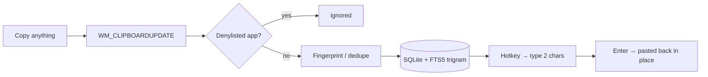

<div align="center">

# ClipNest

**Your clipboard, but it remembers.**

A local-first clipboard history for Windows. Every snippet you copy stays searchable —
offline, on your own disk, in a single SQLite file.

[](https://dotnet.microsoft.com/)
[](#requirements)
[](#)
[](#build--test)
[](#privacy)
[](LICENSE)

**English** · [简体中文](README.zh-CN.md)

</div>

---

## The problem

You copy a stack trace. Then a URL. Then a phone number.

The stack trace is gone. You were going to need it.

Windows keeps exactly one thing on the clipboard — the most recent. Everything else is silently
thrown away, dozens of times an hour. ClipNest is the net underneath: it quietly keeps every text
snippet you copy, and gives it back to you in under a second.

## What you get

- **Instant recall** — hit `Ctrl+Alt+V`, type two or three characters, press `Enter`. The snippet is
  back on your clipboard and the window is gone. No tab switching, no note-taking app.
- **Search that actually works for Chinese** — powered by SQLite FTS5 with a `trigram` tokenizer, so
  a one-character query like `码` matches immediately. Most clipboard tools drop to a full table scan
  here, or worse, match nothing at all.
- **Deduplication that respects your habits** — copy the same text ten times and you get *one* entry
  with a `copied 10×` badge, not ten rows. Copy A, then B, then A again: still two entries.
- **Quiet by design** — tray only. No toast on every copy, no splash, no account, no "sign in to
  continue". It never phones home because it has nowhere to phone.
- **Pause and denylist** — one click to stop collecting; password managers are excluded out of the
  box.
- **Pick and paste in place** — hit the second hotkey inside any app and a compact picker opens with
  your history. Choose an entry and it is pasted straight into the field you were typing in, no
  switching back to a manager window. This is the CLCL workflow people have missed for years.
- **Edit a snippet in place** — the detail pane is an editor, not just a preview. Fix a typo or trim a
  block you copied, then hit **Save** (or `Ctrl+S` while the editor has focus): the history entry, the
  on-disk record, and the system clipboard are all updated together, and your next paste uses the edited
  text. **Back / Forward** buttons give you undo / redo while editing.
- **Pinned and starred entries survive cleanup** — when the store hits its cap, the oldest
  *unprotected* entries go first. Your keepers don't.
- **Light or dark, in your colour** — light by default, or follow the Windows setting. Six accent
  colours, applied live without a restart.

## Requirements

- Windows 10 or 11
- [.NET 8 SDK](https://dotnet.microsoft.com/download) **or newer** (`global.json` rolls forward to
  any later major, so .NET 9/10 works too)

## Try it

```bash
git clone https://github.com/mingq360/ClipNest.git
cd ClipNest
dotnet run --project src/ClipNest
```

First launch opens a short setup window: pick the hotkey that summons the window, and confirm which
apps should never be recorded. Then it disappears into the tray and starts collecting.

## Keyboard

The whole loop is keyboard-only — the window takes focus in the search box, so your hands never
leave the home row.

| Key | Action |
| --- | --- |
| `Ctrl+Alt+V` | Summon / dismiss the window (configurable) |
| `Alt+C` | Open the history picker and paste directly into the window you were in |
| `↑` `↓` | Move through results without leaving the search box |
| `Enter` | Copy the selected snippet and hide |
| `Ctrl+P` | Pin / unpin |
| `Ctrl+S` | Star / unstar — **or save the edit when the detail editor has focus** |
| `Delete` | Delete the selected snippet (edits text normally while the detail editor has focus) |
| `Esc` | Hide |

## How it works



There is no polling. The app registers `AddClipboardFormatListener` on a hidden message window and
wakes up only when the clipboard actually changes — idle CPU is zero.

## Design notes

The parts that took actual thought, in case you are building something similar.

**An index that quietly did nothing.** The obvious schema is `CREATE INDEX ... ON clips(content)` and
then query with `LIKE '%keyword%'`. `EXPLAIN QUERY PLAN` says `SCAN clips`: a leading wildcard can
never use a B-tree index. The index was decoration. Real fix: an FTS5 table with
`tokenize='trigram'`, where `LIKE` *can* be index-accelerated.

**`MATCH` is the wrong tool for Chinese.** Trigrams need at least three characters, so `MATCH '密码'`
returns zero rows — and two-character queries are exactly what people type in Chinese. `LIKE '%密码%'`
against the trigram table returns correct results for one, two, or three characters. So the query
path uses `LIKE ... ESCAPE '\'` uniformly. Bonus: `MATCH` chokes on an unescaped `"` with
`unterminated string`, while a parameterized `LIKE` cannot.

**A denylist that leaked.** The naive design asks `GetForegroundWindow()` when the clipboard event
arrives. Copy a password in your password manager, hit `Alt+Tab` immediately, and by the time the
message is processed the foreground window is something else — the denylist misses, and the password
lands in the database. ClipNest instead tracks the foreground window continuously with
`SetWinEventHook(EVENT_SYSTEM_FOREGROUND)` and reads a snapshot at event time.

**The clipboard echo.** Clicking a history entry writes it back to the clipboard, which fires another
`WM_CLIPBOARDUPDATE`, which would create a new entry — a small self-feeding loop. The writer records a
fingerprint of what it just wrote; an identical read within 1.5 s is recognised as an echo and dropped.

**Numbers, measured not guessed.** 5,000 entries: query latency 1–3 ms. A full
`INSERT` of 5,000 rows through the triggers: ~136 ms. Release build at rest: 48 MB private bytes,
128 MB working set (WPF's shared pages account for most of the gap — judge by private bytes).

**A global shortcut that swallowed typing.** The window handles keys in `PreviewKeyDown` (a tunneling
event), so `Delete` removes the selected entry from anywhere. Once the detail pane became an editable
TextBox, that same handler started eating `Delete` inside the editor — you couldn't delete a single
character. The fix keys off `ContentBox.IsKeyboardFocusWithin`: while editing, the window-level
shortcuts stand down (`Ctrl+S` is deliberately re-mapped to Save instead of Star). Switching rows also
resets the TextBox undo stack, so undoing an edit on one entry can't bleed into the next.

## Privacy

ClipNest has no server, no telemetry, no update checker, no crash reporter. You can verify that with
a firewall rule and watch it make zero connections.

- **Data location** — `%LOCALAPPDATA%\ClipNest\` (`clipnest.db`, `settings.json`, `logs\`)
- **Denylist** — matched by process name, pre-seeded with common password managers
- **Pause** — stops the clipboard listener entirely, not just the writes
- **Honest limitation** — a denylist based on process names cannot tell apart a web-based password
  manager running inside your browser. If you keep secrets in a browser tab, use pause, or put the
  whole browser on the list.

## Status

| Area | State |
| --- | --- |
| Clipboard capture, history, search, copy-back | ✅ working |
| Pin / star / delete / clear, capacity cleanup | ✅ working |
| Edit a snippet in place (save / undo / redo) | ✅ working |
| Tray, global hotkeys, single instance, autostart | ✅ working |
| Pause, denylist, first-run setup | ✅ working |
| Tags, source filtering, import/export | ⬜ roadmap |
| Images / rich text | ⬜ deliberately out of scope (text only) |

## Build & test

```bash
dotnet build ClipNest.sln
dotnet test tests/ClipNest.Tests
```

77 tests cover the repository layer, schema migrations, the classifier, the fingerprinting rules, and
the capture orchestration (pause, denylist, dedupe, truncation, capacity pruning).

```
src/ClipNest/
├── Domain/           entities, classification, dedupe fingerprint, repository contract
├── Services/         capture orchestration, settings, hotkey grammar
├── Infrastructure/   SQLite, clipboard listener, foreground tracker, hotkeys, logging
└── UI/               main window, settings, tray, view models
tests/ClipNest.Tests/ 77 tests
docs/                  requirements and design docs (Chinese)
```

The design docs in `docs/` record the decisions *and* the corrections — including the three bugs
above, which were caught and fixed while writing this code rather than after shipping it.

## Package

```powershell
.\publish.ps1
```

Produces **one file**: `artifacts/publish/win-x64/ClipNest.exe` (~65 MB). Self-contained, so it runs
on any Windows 10/11 machine with nothing installed — copy it to a USB stick and it works.

```powershell
.\publish.ps1 -FrameworkDependent   # → artifacts/publish/win-x64-fdd/  (~2.9 MB, needs .NET 8 Desktop Runtime)
.\publish.ps1 -Runtime win-arm64    # ARM64 devices
```

Two notes on the build:

- **No trimming.** `PublishTrimmed` is not supported for WPF — it breaks XAML reflection. Size comes
  from single-file compression instead, and **that compression only applies to self-contained
  builds** (framework-dependent + compression fails with `NETSDK1176`).
- **Native libraries are extracted at first run** (`IncludeNativeLibrariesForSelfExtract`), because
  SQLite's `e_sqlite3.dll` cannot be loaded from inside the bundle. They land in
  `%TEMP%\.net\ClipNest\…` and are reused on later launches.

## License

MIT. Take it, fork it, ship it — just keep the copyright notice.

See [LICENSE](LICENSE) for the full text.
