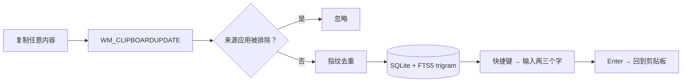

<div align="center">

# ClipNest

**一个会记住一切的剪贴板。**

本地优先的 Windows 剪贴板历史工具。复制过的每一段文字都留在你自己的硬盘上，
只用一个 SQLite 文件，随时搜回来。

[](https://dotnet.microsoft.com/)
[](#环境要求)
[](#)
[](#构建与测试)
[](#隐私)
[](LICENSE)

[English](README.md) · **简体中文**

</div>

---

## 它解决什么问题

你复制了一段报错信息。然后又复制了一个链接。接着又复制了一个手机号。

报错信息没了。而你等下就要用到它。

Windows 的剪贴板只保留最后一次复制的内容，其余的在悄无声息中被丢掉——一天几十次。
ClipNest 就在下面兜着：你复制过的每一段文本它都留着，一秒之内还给你。

## 你能得到什么

- **一秒钟找回来** —— 按 `Ctrl+Alt+V`，敲两三个字，`Enter`。内容回到剪贴板，窗口消失。
  不用切标签页，不用打开笔记软件。
- **中文搜索是真的能用** —— 底层是 SQLite FTS5 的 `trigram` 分词，搜单个汉字「码」也能立刻命中。
  多数同类工具在这里会退化成全表扫描，或者干脆一条都搜不出来。
- **去重懂你的习惯** —— 同一段文字复制十次，仍然只是一条记录，标着「复制 10 次」，
  而不是十行。复制 A、再复制 B、再复制 A，也还是两条。
- **安静** —— 只待在托盘。每次复制不弹提示，没有启动画面，不用登录，不存在「请先注册」。
  它从不联网，因为根本没有要连的地方。
- **能暂停，也能拉黑** —— 单击暂停采集；常见密码管理器默认就在排除名单里。
  暂停期间按 `Ctrl+Alt+C` 仍可强制收藏当前剪贴板。
- **置顶和收藏不会被清掉** —— 存满之后优先删最久没用的「未保护」条目，你留着的那些一条不动。

## 环境要求

- Windows 10 或 11
- [.NET 8 SDK](https://dotnet.microsoft.com/download) **或更新版本**
  （`global.json` 设了向上滚动，装 .NET 9 / 10 也可）

## 跑起来

```bash
git clone https://github.com/mingq360/ClipNest.git
cd ClipNest
dotnet run --project src/ClipNest
```

首次启动会弹一个简短的初始设置：选一个唤起窗口的快捷键，确认哪些程序的内容不要记录。
设置完它缩进托盘，开始默默干活。

## 键盘操作

整个流程可以完全不碰鼠标——窗口打开时光标就在搜索框里，手不用离开主键区。

| 按键 | 作用 |
| --- | --- |
| `Ctrl+Alt+V` | 唤起 / 收起窗口（可自定义） |
| `Ctrl+Alt+C` | 立即收藏当前剪贴板（暂停中也生效） |
| `↑` `↓` | 在搜索结果间移动，光标不离开搜索框 |
| `Enter` | 复制选中项并收起窗口 |
| `Ctrl+P` | 置顶 / 取消置顶 |
| `Ctrl+S` | 收藏 / 取消收藏 |
| `Delete` | 删除选中项 |
| `Esc` | 收起窗口 |

## 工作原理



没有轮询。应用在一个隐藏消息窗口上注册 `AddClipboardFormatListener`，只在剪贴板真的变化时才醒来，
空闲时 CPU 占用为零。

## 设计笔记

值得动脑子的几处，写给同样在做这类工具的人。

**一个什么都没干的索引。** 最直觉的做法是 `CREATE INDEX ... ON clips(content)`，然后
`LIKE '%关键词%'` 查询。但 `EXPLAIN QUERY PLAN` 明明白白写着 `SCAN clips`——前导通配符永远用不上
B-tree 索引，那个索引纯属装饰。真正的解法是 FTS5 表配 `tokenize='trigram'`，在这样的表上
`LIKE` 才能吃到索引。

**`MATCH` 不适合中文。** trigram 至少需要三个字符，所以 `MATCH '密码'` 返回零条——而中文里
最常敲的就是两个字。换成 `LIKE '%密码%'` 打到 trigram 表上，一个字、两个字、三个字全都正确。
于是查询路径统一走 `LIKE ... ESCAPE '\'`。附带好处：`MATCH` 遇到没转义的 `"` 会抛
`unterminated string`，参数化的 `LIKE` 天然没这个毛病。

**漏了的排除名单。** 最容易写的做法，是在剪贴板事件到达时调 `GetForegroundWindow()` 问「谁在前台」。
可你在密码管理器里 `Ctrl+C` 之后立刻 `Alt+Tab`，等消息被处理时前台已经换了程序——排除名单没命中，
密码就这么进了数据库。ClipNest 改用 `SetWinEventHook(EVENT_SYSTEM_FOREGROUND)` 持续跟踪前台窗口，
事件到达时只读快照。

**剪贴板回声。** 点击历史条目会把内容写回剪贴板，这又会触发一次 `WM_CLIPBOARDUPDATE`，
于是再生成一条新记录——一个自我投喂的小循环。写入方会记下自己刚写的指纹，1.5 秒内读到相同内容
就判定为回声丢弃。

**数据是量出来的，不是猜的。** 5000 条记录：查询 1~3ms；连带触发器一次性插入 5000 条约 136ms；
Release 空载私有内存 48MB、工作集 128MB（差的那部分主要是 WPF 的共享页，考核请按私有内存看）。

## 隐私

ClipNest 没有服务端、没有埋点、没有更新检查、没有崩溃上报。你可以加一条防火墙规则自己验证：
它建立的连接数是零。

- **数据位置** —— `%LOCALAPPDATA%\ClipNest\`（`clipnest.db`、`settings.json`、`logs\`）
- **排除名单** —— 按进程名匹配，已预置常见密码管理器
- **暂停** —— 直接停掉剪贴板监听，而不只是不写库
- **诚实的局限** —— 按进程名匹配区分不了「浏览器里打开的网页版密码管理器」。
  如果你把密码放在浏览器标签页里，请用暂停，或者干脆把整个浏览器加进排除名单。

## 当前状态

| 模块 | 状态 |
| --- | --- |
| 采集、历史、搜索、复制回剪贴板 | ✅ 可用 |
| 置顶 / 收藏 / 删除 / 清空、容量清理 | ✅ 可用 |
| 托盘、全局快捷键、单实例、开机自启 | ✅ 可用 |
| 暂停、排除名单、首次启动引导 | ✅ 可用 |
| 标签、按来源筛选、导入导出 | ⬜ 路线图 |
| 图片 / 富文本 | ⬜ 有意不做（仅纯文本） |

## 构建与测试

```bash
dotnet build ClipNest.sln
dotnet test tests/ClipNest.Tests
```

66 个测试覆盖仓储层、库结构迁移、类型判定、指纹规则，以及采集编排（暂停、排除名单、去重、
超长截断、容量清理）。

```
src/ClipNest/
├── Domain/           实体、类型判定、去重指纹、仓储契约
├── Services/         采集编排、配置、快捷键文法
├── Infrastructure/   SQLite、剪贴板监听、前台窗口跟踪、热键、日志
└── UI/               主窗口、设置、托盘、视图模型
tests/ClipNest.Tests/ 66 个用例
docs/                需求文档与方案设计文档
```

`docs/` 里那两份文档记录了决策过程**和**修正记录——包括上面三个坑，都是写代码时发现并改掉的，
不是上线之后才踩到的。

## 许可证

MIT。随便用、随便改、随便发，保留版权声明即可。

完整条款见 [LICENSE](LICENSE)。
